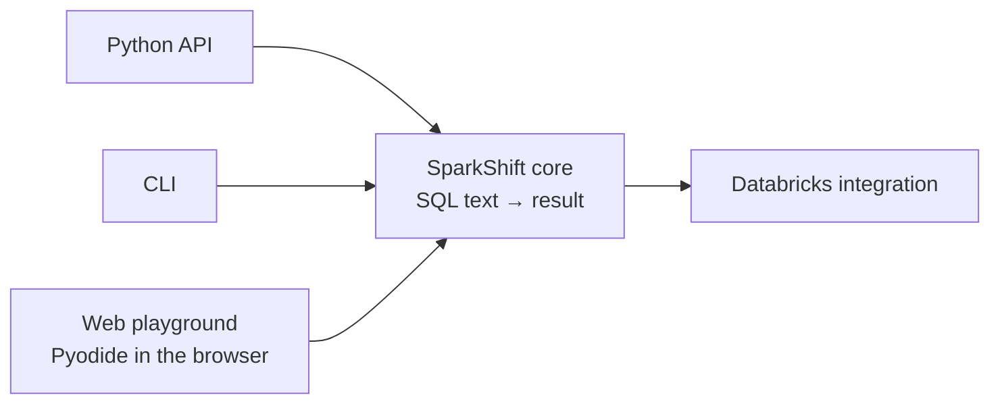
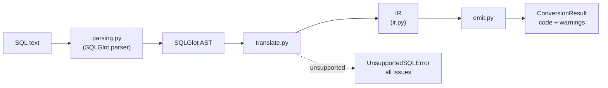

# Architecture

> **Status:** SQL and the documented SAS subset use the shared pipeline.
> The Python API, CLI, public playground, notebook generation, and notebook
> upload exist; the examples have been validated on a Databricks workspace
> ([databricks-validation.md](databricks-validation.md)).

## The core idea

SparkShift's core is a **pure translation function**: SQL text goes in, a
structured result comes out. Everything else — the command line, the browser
playground, Databricks — is a thin interface around that function.

## Translation pipeline

| Stage | Module | Responsibility |
|---|---|---|
| Frontend | `parsing.py` | SQL text → SQLGlot syntax tree; converts SQLGlot errors into SparkShift errors ([ADR 0001](adr/0001-use-sqlglot-for-parsing.md)) |
| Frontend | `translate.py` | Syntax tree → IR. Works from an allowlist: anything it does not explicitly handle is reported as unsupported, and all issues are collected before failing |
| Middle | `ir.py` | SparkShift's own description of DataFrame operations ([ADR 0003](adr/0003-introduce-a-small-ir.md)) |
| Backend | `emit.py` | IR → readable PySpark source: plain code, or a pipeline source file's functions |
| SAS frontend | `sas_lexer.py`, `sas_parser.py`, `sas_datalines.py`, `sas_translate.py` | SAS program → tokens → a small syntax tree → IR, one named relation per data set (DATA steps, with data lines read at conversion time, and PROC SORT, MEANS/SUMMARY, FREQ, and SQL), following SAS's documented rules ([ADR 0005](adr/0005-sas-has-its-own-front-end.md), [ADR 0006](adr/0006-proc-sql-follows-sas-rules.md), [sas.md](sas.md)) |
| Entry point | `api.py` | `convert(sql, dialect)` runs the stages in order; with `dialect="sas"`, the SAS frontend's |
| Notebooks | `notebook.py` | Generated code as a Databricks source-format notebook: a Markdown description, one cell per section, and `display(result)` ([ADR 0007](adr/0007-databricks-notebooks.md)) |
| Analysis | `report.py` | Calls `convert` for many files and summarizes the outcomes: pure functions and data, with text, Markdown, and JSON formats; it reads no files |
| Databricks | `databricks.py` | Imports notebooks into a workspace through the optional Databricks SDK, imported only when uploading; credentials come from the SDK's own sources and are redacted from every message ([ADR 0010](adr/0010-upload-notebooks-with-the-databricks-sdk.md)) |
| Jobs | `jobs.py` | The Databricks job that runs uploaded notebooks in order, as one Jobs API body, and the notebook that creates it in a workspace ([ADR 0012](adr/0012-create-jobs-from-one-description.md)) |
| Pipelines | `pipelines.py` | Generated code as a Lakeflow pipeline source file, one dataset per data set or query, emitted from the same plan as the plain code; and the pipeline itself, as one Pipelines API body, and the notebook that creates it ([ADR 0013](adr/0013-pipelines-from-the-same-plan.md)) |
| Batches | `batch.py` | The rules for converting many files, shared by the command line and the playground: which files are converted, the dialect of each, and which output paths collide |
| Command line | `cli.py` | Reads and writes files, and calls `convert`, `report`, or the upload |

Only `parsing.py` and `translate.py` may import SQLGlot; the IR, the emitter,
and the SAS frontend never depend on it; and only `databricks.py` imports the
Databricks SDK, never when the package is imported. These rules are enforced
by `tests/test_architecture.py`.

### Errors and warnings

Errors are exceptions; warnings are data. Every exception derives from
`SparkShiftError`. A query that cannot be translated safely raises
`UnsupportedSQLError`, whose `issues` list every unsupported construct. A
successful conversion returns a `ConversionResult` whose `warnings` describe
anything the user should review.

### Generated-code contract

Generated code imports what it uses, assigns the final DataFrame to a variable
named `result`, and expects a SparkSession named `spark` to exist, as in a
Databricks notebook. Queries that join tables declare each source table once as
a variable named after the table; joined tables are aliased (with their SQL
alias, or their own name when needed) so qualified columns such as `c.name`
resolve exactly as in SQL, including in self-joins. Each distinct window
(`PARTITION BY` and `ORDER BY`) is declared once, as a variable named
`window`, or `window_1`, `window_2`, and so on, that window functions share.
Each CTE and each subquery in `FROM` becomes a variable named after it,
declared once, after the variables it uses; a CTE used twice is computed
from the same variable. The other query of a set operation is written as a
chain nested inside the call, as in `.union(...)`. A subquery in an
expression becomes a variable used with Spark's subquery methods:
`.isin(subquery)`, `subquery.exists()`, and `subquery.scalar()`, with
`F.col(...).outer()` for the enclosing query's columns.
Parentheses follow
Python's operator precedence, not SQL's, because PySpark expressions are
built from Python operators (`&` and `|` bind more tightly than `==`).

Code is laid out to fit 88 columns, the Black and Ruff default. Short code
stays on one line. A long chain step puts each argument on its own line; a
long `&`/`|` chain, comparison, or arithmetic expression puts one operand per
line with the operator leading, and a nested operator expression that still
does not fit gets its own parentheses, so `a >= (b + c)` cannot be misread as
`(a >= b) + c`; a long `F.when` chain puts one branch per line; a long
function call puts one argument per line; and a long expression that needs
parentheses before `.alias` gets its own lines inside them. Wrapping only adds
line breaks and grouping parentheses, so the code means exactly the same at any
width. A single piece that cannot be split, such as a very long column name,
can still exceed the limit.

### Helper columns

Temporary columns occupy a separate symbolic namespace when the source's
columns are unknown. The emitted program reads the input DataFrame's column
names and reserves names visible in the operation before selecting unused
helper names; references and drops use those bindings. Known outputs use a
static name allocator instead. Both conservatively ignore case to protect
users on either Spark name-resolution setting. See
[ADR 0008](adr/0008-protect-generated-helper-column-names.md).

## Rules for the core

These rules keep every planned interface possible:

1. **No I/O.** The core does not read files, print, read environment variables,
   or use the network. Input is a string; output is data. Interfaces own I/O.
2. **No Spark.** The core generates PySpark code but never imports PySpark
   ([ADR 0002](adr/0002-pyspark-is-not-a-runtime-dependency.md)).
   Enforced by `tests/test_architecture.py`.
3. **Pure-Python dependencies only.** Anything the core depends on must run in
   Pyodide (Python compiled to WebAssembly), so the playground can run without
   a server.
4. **Structured results, not just strings.** A conversion returns the generated
   code together with warnings and unsupported constructs, so every interface
   can present them in its own way.
5. **Deterministic output.** The same input always produces exactly the same
   code. This makes golden-output tests possible and diffs meaningful.

## How each interface will use the core

| Interface | Responsibility | Core rule it relies on |
|---|---|---|
| **Python API** | Call the conversion function directly from Python code. | Structured results |
| **CLI** | Read SQL from a file or stdin, print code to stdout, warnings to stderr, and return meaningful exit codes. | No I/O in core |
| **Web playground** | Load the SparkShift and SQLGlot wheels into Pyodide in the browser and call the core from JavaScript. No backend server ([ADR 0004](adr/0004-run-the-playground-in-the-browser.md)). | Pure Python, no Spark |
| **Databricks** | Wrap generated code in notebook format, or as pipeline source files; optionally deploy them, with a job or a pipeline, through the Databricks SDK as an optional extra (`sparkshift[databricks]`), with credentials from the environment. | No Spark, no I/O in core |

## How correctness is verified

The browser playground never runs Spark. Correctness is verified separately, in
CI: for each supported query, the test suite executes both the original SQL
(`spark.sql(...)`) and the generated PySpark against the same data on real
Apache Spark, and compares the results with SQL semantics in mind (row order,
NULLs, duplicates, types).
